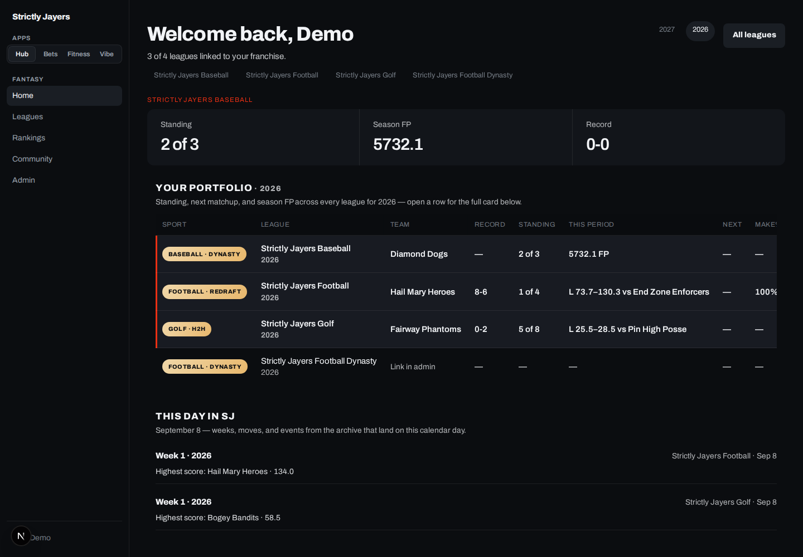
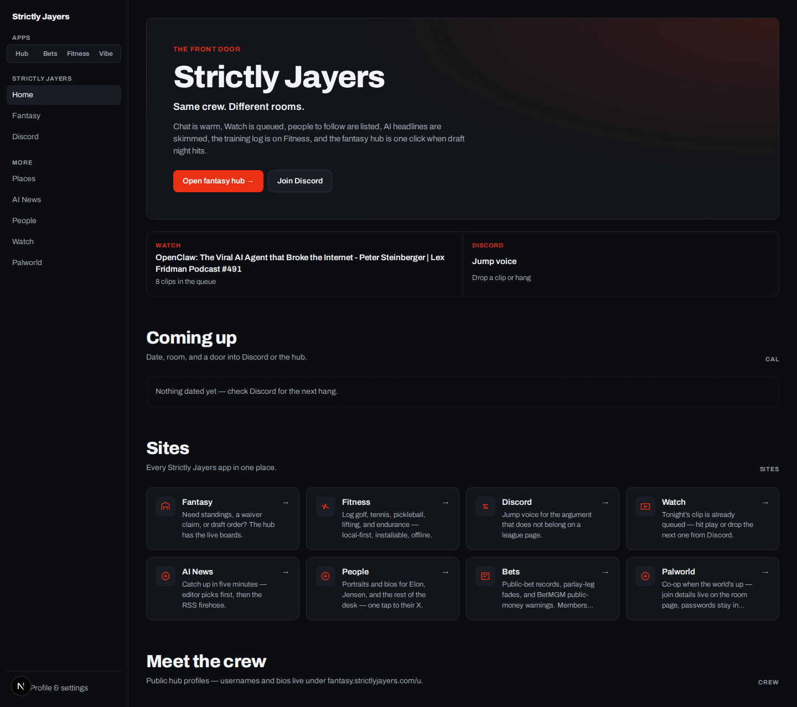
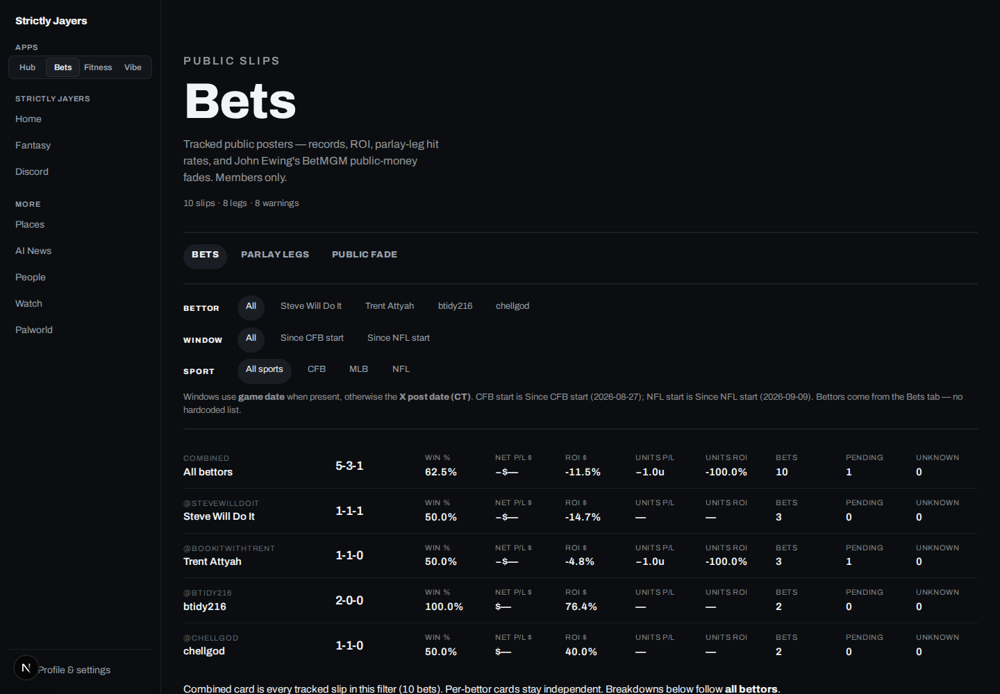
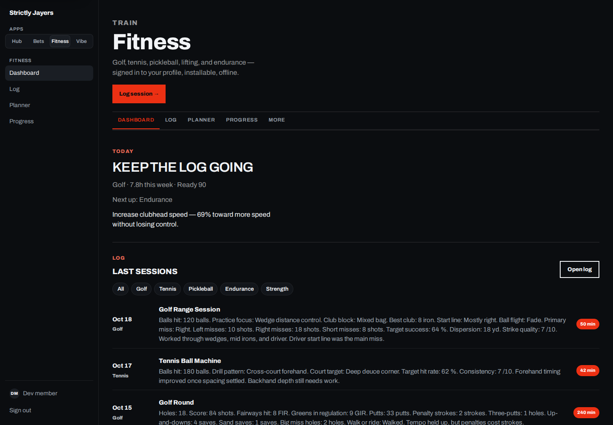
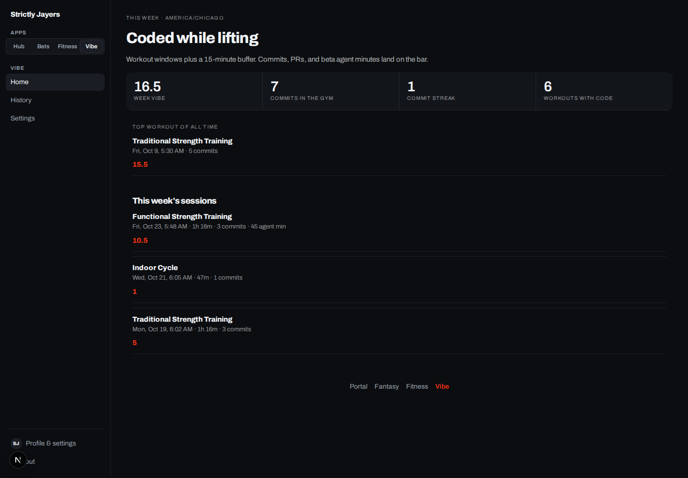
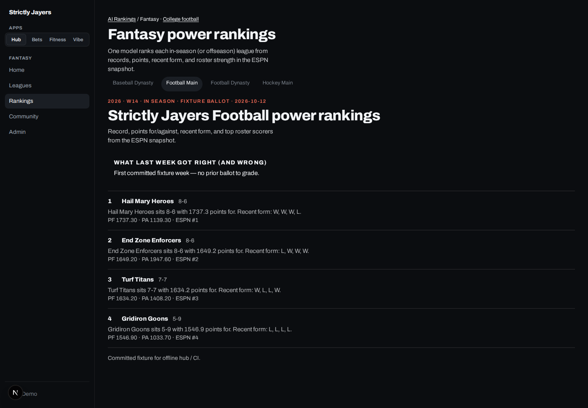

# Strictly Jayers

[](https://github.com/thejayer/fantasy-sports/actions/workflows/tests.yml)
[](LICENSE)

A multi-sport fantasy **community**, not a weekend projection script. One
monorepo ships the public front door, the member hub, a training log, a
coded-while-lifting board, and the NFL analytics engine that feeds the
football tools.

| Surface | Live |
|---|---|
| Community portal | [strictlyjayers.com](https://strictlyjayers.com) |
| Member hub | [fantasy.strictlyjayers.com](https://fantasy.strictlyjayers.com) |
| Fitness log | [fitness.strictlyjayers.com](https://fitness.strictlyjayers.com) |
| Vibe Split | [vibe.strictlyjayers.com](https://vibe.strictlyjayers.com) |

Screenshots below are **fixture data** from local apps — synthetic leagues,
demo sessions, and public-handicapper sample slips. No production member
names, emails, or live P/L.

## Product

**Member hub** — standings, rosters, matchups, draft results, feed, and
decision tools across football, baseball, hockey, and golf.



**Community portal** — the public front door. Fantasy, fitness, watch,
people, and bets each have their own room.



**Bets** — members-only board for public slips, parlay legs, and
public-money fades. Dollar amounts are scrubbed in this shot.



**Fitness** — golf, tennis, pickleball, lifting, and endurance. Local-first
PWA on its own host so a service worker never touches the apex.



**Vibe Split** — workout windows overlapped with GitHub commits.



**AI rankings** — one model ballot per league from the snapshot, not an
average of five websites.



## What this is

Strictly Jayers is a private-league community that grew a real product
around the season:

- **Hub** (`apps/web`) — ESPN-synced football, baseball, and hockey plus a
  hub-native golf auction. Standings, rosters, matchups, draft tape, feed,
  Hall of Shame, scoring lab, and football tools (trade desk, waivers,
  start/sit, playoff odds, draft sim).
- **Portal** (`apps/www`) — public community home. Absolute links into the
  hub and fitness; `/bets` is the one signed-in page on this host.
- **Fitness** (`apps/fitness`) and **Vibe** (`apps/vibe`) — sibling apps
  with the same Google sign-in as the hub, per-member JSON stores, no
  shared guest log.
- **`ffa`** — NFL ingest, scoring, distributional projections, VOR, draft
  sim, and walk-forward backtests. The hub **reads** exported JSON; Next
  handlers never invoke the engine.
- **`sj`** — sync CLI that writes versioned snapshots. Hockey adds an NHL
  data layer (`src/nhl`); golf scoring lives in `src/sg`.

Deeper product notes: [HUB.md](HUB.md), [PORTAL.md](PORTAL.md),
[FITNESS.md](FITNESS.md), [VIBE.md](VIBE.md), [ROADMAP.md](ROADMAP.md).

## Why it exists

The old path was a pile of R scrapers against projection-site HTML that
broke every August, plus ESPN's own UI for everything else. This repo
replaces that with:

1. **One ingest** from [nflverse](https://github.com/nflverse) and a pure
   scoring function driven by YAML league configs.
2. **Offline snapshots** the hub can render without calling ESPN from a
   request.
3. **One visual system** so the four sites feel like one product.

Football projections are distributional (block bootstrap + a calibrated
level model). Baseball and hockey stay projection-free by design — ESPN
categories and season-points analysis, not a half-built MLB/NHL engine.

## Stack

| Layer | Choice |
|---|---|
| Apps | Next.js 16 (Turbopack locally, standalone on Cloud Run) |
| Auth | Auth.js + Google on hub, fitness, vibe, and portal `/bets` |
| Design | Shared `packages/sj-ui` (Modernist tokens, vendored per app) |
| Snapshots | `sj` CLI → JSON (`fixtures/sj` in CI; live store in production) |
| Analytics | Python 3.11+ `ffa` — pytest-offline, Parquet + DuckDB locally |
| Hockey | `src/nhl` (stdlib + PyYAML) beside the ESPN snapshot |
| Golf | `src/sg` scoring + hub auction room |
| Hosting | Four Cloud Run services + scheduled sync / export jobs |
| CI | Ruff + pytest (3.11/3.12), Next lint/typecheck/Vitest, Playwright |

## Architecture

```
  ESPN / nflverse / NHL APIs          Apple Health / GitHub
           │                                  │
           ▼                                  ▼
   sj · ffa · nhl CLIs                 fitness / vibe ingest
   (scheduled Cloud Run jobs)          (per-member JSON)
           │
           ▼
      snapshot store  ──read──►  Next.js apps
                                 apps/www   community portal
                                 apps/web   member hub
                                 apps/fitness
                                 apps/vibe
                                      │
                                      └── packages/sj-ui
```

Nightly jobs refresh projections, player maps, playoff odds, rankings, and
league snapshots. The web apps only read those files (tagged Next cache,
`EmptyState` when a concern is missing). Request handlers do not scrape
ESPN, call `ffa`, or hit model APIs.

Member surfaces share one Google client. Public portal routes (home, watch,
people, AI, Palworld) need no session. Fitness keeps its service worker off
the apex so community pages stay uncached by a PWA.

## Local development

Python engine (offline tests, no ESPN cookies):

```bash
python -m venv .venv && source .venv/bin/activate
pip install -e ".[dev]"
pytest
ruff check .
```

Next apps (fixture snapshots, skip Google):

```bash
# Hub — http://localhost:3000
cd apps/web
printf 'AUTH_DEV_BYPASS=1\nAUTH_SECRET=dev\nSJ_DEV_VIEWER_EMAIL=demo@example.com\n' > .env.local
npm install && npm run dev

# Portal — http://localhost:3002
cd ../www && npm install && AUTH_DEV_BYPASS=1 npm run dev

# Fitness — http://localhost:3003
cd ../fitness && npm install && AUTH_DEV_BYPASS=1 npm run dev

# Vibe — http://localhost:3005
cd ../vibe && npm install && AUTH_DEV_BYPASS=1 npm run dev
```

`AUTH_DEV_BYPASS` is local/CI only. The hub falls back to `fixtures/sj`
when no live snapshot directory is set. Full hub notes: [HUB.md](HUB.md).

Optional `ffa` ingest (needs network to nflverse):

```bash
ffa ingest --season 2023 --season 2024
ffa rank --season 2025 --league configs/ppr.yaml --samples 200
```

Longer engine walkthrough: [docs/ffa.md](docs/ffa.md). Dashboard deploy
sketch: [DEPLOY.md](DEPLOY.md).

## Analytics engine (`ffa`)

`src/ffa` is a modern replacement for the legacy R pipeline:

- YAML league configs; scoring is a pure function of a stats frame.
- Recency-weighted projections and a joint posterior via weighted block
  bootstrap (optional learned / quantile generators).
- VOR, tiers, ILP lineup optimizer, Monte Carlo draft sim.
- Empirical games-played model + a conditioned level / role-collapse
  model so floors and busts are not just “17 healthy games.”
- Walk-forward backtests (MAE, Spearman, pinball, coverage).
- Hub exporters: season projections, weekly start/sit, player map,
  playoff-odds samples.

```bash
ffa simulate --season 2025 --league configs/ppr.yaml --samples 1000
ffa export-projections --season 2025 --league configs/ppr.yaml \
  --out-dir data/sj/projections --format both
```

Phase-by-phase design notes and backtest tables live in
[docs/ffa.md](docs/ffa.md).

## More

- [AUDIT.md](AUDIT.md) — security / correctness baseline
- [AUDIT-COMPETITIVE.md](AUDIT-COMPETITIVE.md) — gaps vs ESPN / Yahoo / Sleeper
- [ROADMAP.md](ROADMAP.md) — phases 0–9 + portal track
- [HOCKEY-PORT.md](HOCKEY-PORT.md) — NHL data layer
- [docs/portfolio/](docs/portfolio/) — how the README shots were captured

## License

[GPL-3.0](LICENSE)
